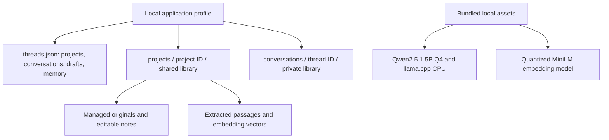

# Clue

A local Windows chat app with project workspaces, document retrieval, public web research and a bounded multi-step agent. Inference and embeddings run on the CPU; no cloud inference endpoint is used.

## Run from this repository

The models and dependencies are already present on this computer. Open a terminal in this folder and run:

```powershell
npm run dev
```

This launches the desktop app directly from source, watches `src/` and restarts after edits. It keeps a separate, persistent development profile in `.dev-data/`, so chats and project files survive restarts. Ctrl+C stops the watcher and app. No installation or executable rebuild is needed. `npm start` also runs from source, without watching, using the normal application profile.

For a fresh checkout, use Node.js 22 or newer on Windows:

```powershell
npm ci
npm run assets
npm run assets:embeddings
npm run dev
```

Asset downloads happen only during developer setup. Runtime/model revisions and checksums are pinned in the two manifests under `assets/`. Large binaries, private profiles, test data and build output are excluded from Git. No remote Git repository is configured automatically.

Previous installer EXEs, blockmaps and ZIPs have been removed. No replacement installer was generated for this update. An older `dist/win-unpacked` development artifact may remain; run source to test current behavior. Packaging is an explicit, separate action with `npm run build` when requested.

## Using the app

New chats are temporary until the first message is submitted. Empty chats and unsent drafts do not appear in Recents, project chat lists, search, or the saved thread store. The first submitted turn saves the conversation, including interrupted or failed replies; drafts in an already started conversation still persist. Projects themselves can be saved without any chats.

The left sidebar groups conversations beneath expandable project rows. Use the + beside Projects to create a project, the + on a project row to create a conversation in it, or New conversation / Recents + to create a standalone chat shown only in Recents. Long lists have Show more. Each project has separate files, notes and conversations. The right-hand drawer is a dedicated file preview. Use its search icon (Ctrl+P) to filter files available to the current chat in a modal; opening a result only previews it and never submits a chat request. **Use in chat** explicitly adds or removes that file from retrieval context. With no files selected, only this chat’s own files and explicitly shared files from its project are available for document requests. The + icon imports PDF, Word, text, Markdown and CSV; notes are read-only until you choose Edit note. Drag the divider to resize, drag toward the right edge to collapse, or use the collapse button. Width and open state are remembered. The focused divider also supports left/right arrows and Enter to collapse. Web references are saved per conversation and can be previewed in the same pane.

Use the **+ inside the message box** to choose attachments with the native file picker. You can also drag up to 20 documents from File Explorer onto the middle chat pane. A drop indicator appears, supported files are imported and indexed locally, and successfully imported files are selected as context for the current conversation. Attached files appear as cards above the message box, showing their names and file types. Click a card to preview it in the right drawer; its × button removes it from conversation context without deleting the stored file. Cards show an Adding status during import. On Send, attachment names and IDs are saved on the user message, cards appear above that sent message, and the composer clears. Files remain available as retrieval context for follow-ups without repeating the cards in every draft. Sent cards survive restarts and can still open the stored file; if a file is deleted, its original attachment name remains in history. Dropping never submits the draft or starts a chat response. Existing imports are deduplicated; invalid files report individual errors.

Ask naturally. There is no web selector or manual search box. The router executes public searches for explicit research, current information, verification/compliance questions and research follow-ups. Summaries and extraction of uploaded documents normally stay local. Say **“Use only project files”** to prevent new network requests for that request. Previously saved public evidence may still be used.

For document-related research, the app first retrieves relevant passages, asks the local model for a generic public topic and checks the query for known identifiers. Regulation and jurisdiction fields must be grounded in the request or retrieved document. The activity timeline shows routing, retrieval, the exact outgoing query, page reads, compaction and response generation. These are execution events, not hidden model reasoning.

Documents and conversation text are not uploaded wholesale. Public search queries, including topics derived from documents, do leave the machine. Identifier filtering reduces accidental disclosure but cannot recognize every confidential concept. Web search uses a public HTML endpoint and can be rate-limited or blocked; unreadable pages are clearly identified as snippets.

Chat search sits beside Clue in the sidebar header (Ctrl+K). The modal searches both titles and messages across standalone and project chats. Arrow keys, Enter, Escape and focus restoration are supported for both search dialogs.

The interface uses locally bundled [shadcn/ui](https://ui.shadcn.com/docs/components/radix/dialog) Button, Input and Dialog components with Radix focus management and Lucide icons. Source components live in `src/ui/components/`, with their MIT license. React is used for these UI controls; the existing chat workflow remains behind the restricted IPC bridge. `npm run ui:build` compiles the local renderer using esbuild and Tailwind, and source launches rebuild it automatically. Generated assets are in `.renderer/`, excluded from Git. No remote UI resources are loaded.

## Conversation and project boundaries

Chat transcripts, memory, web results, action history and chat attachments stay within their own thread. Cross-thread history stays private unless a chat is explicitly dropped onto a project. New conversation and Recents + create standalone chats with no project. Only a project’s own New conversation action creates a project chat.

Files dropped into the middle chat pane (or imported through Add files) are stored in that conversation’s library. To share a file, drag it from File Explorer, its attachment card, a sent file card, or its preview title onto a project row. This copies it into that project’s shared library; the original chat remains independent. Drag a chat from Recents or another project onto a project row to move it there and share its history and private files. Other chats in the destination project can retrieve relevant completed messages with attribution and read that chat’s files, including later additions. The chat keeps its messages, draft and attachments. Shared thread files stay in their original storage; moving the thread again changes which project can retrieve them. Unmoved chats remain private. Existing project assignments and previously stored project files are preserved; they are not automatically moved or deleted.

Generation uses modest frequency/presence penalties and a streaming repetition guard. A third consecutive repetition of a substantial phrase stops generation, releases the response stream, and adds an incomplete-answer notice. It does not silently restart or present the truncated answer as exhaustive.

## Project source folders

Create project opens a centered dialog with an optional native folder picker. Choose a local folder to make its PDF, DOCX, TXT, Markdown and CSV files available to the project's chats. Subfolders are scanned; hidden directories, dependency/build folders and symbolic links are skipped. Source folders are shared document sources, not permission for the model to run commands or change files.

The preview pane shows the selected path, indexing status, issues and last refresh time. Use **Refresh files** after changing files on disk; scanning is explicit rather than a background watcher. Refresh updates changed documents while retaining their IDs, adds new files, and removes deleted files from the active index only after a complete scan. Missing folders and unreadable files preserve the last indexed copies with a visible warning. Preview and Open indexed copy use those managed copies. Existing response excerpts remain historical records.

Use **Source folder** in a project's menu or **Manage source folder** in its preview pane to replace or disconnect the folder. Source originals are never changed or deleted. The folder path and index metadata persist locally; indexes and cached copies are isolated under the project. A standalone chat cannot access them. A project can also be created without a folder or any saved chats.

To keep indexing bounded on smaller devices, one scan accepts up to 500 supported files / 200 MB total, with a 40 MB per-file limit and 10,000 scanned entries. Limit and parsing failures are shown in the folder status. There is no automatic OCR for scanned PDFs.

## Retrieval and context

The retrieval pipeline is local hybrid RAG:

1. Extract text into overlapping passages (PDF page numbers retained).
2. Encode passages with quantized MiniLM-L6-v2, a roughly 23 MB local ONNX model producing normalized 384-dimensional vectors.
3. Rank project-scoped candidates using BM25 keyword relevance and cosine semantic similarity.
4. Combine the two rankings with reciprocal rank fusion, remove identical passages and select diverse evidence with maximal marginal relevance.
5. Let the local agent perform up to three further search/read actions, then answer with source excerpts.

BM25 preserves exact names, terminology and standard numbers; embeddings retrieve paraphrases; diversity selection reduces redundant context. The index is persisted locally in JSON and searched in memory. This deliberately avoids a database server or costly cross-encoder on modest hardware. It is suitable for a modest project collection; very large corpora will need a disk-backed vector index. Retrieval does not guarantee exhaustive document coverage.

The 8,192-token model window is measured with llama.cpp's chat template and actual tokenizer. Each final prompt reserves 1,000 output tokens plus a 256-token safety margin. When the assembled prompt would exceed that input budget, older turns are summarized locally in bounded batches until usage approaches 62% of capacity, leaving room for subsequent turns. Memory preserves goals, preferences, facts, source IDs, decisions and open tasks; the latest exchange stays exact when space allows. Lower-ranked evidence is dropped and unusually large recent turns are shortened only if still necessary. Original messages remain on disk. Compaction is lossy, but it is automatic and no longer based on an arbitrary message count.

```mermaid
flowchart LR
    UI[Desktop chat and project file pane] --> IPC[Restricted IPC]
    IPC --> STORE[Project and thread persistence]
    STORE --> ROUTE[Intent router]
    ROUTE --> RAG[Local hybrid retrieval]
    RAG --> QUERY[Local public-topic abstraction and guards]
    QUERY --> WEB[Optional public search and page reads]
    RAG --> AGENT[Bounded research agent]
    WEB --> AGENT
    AGENT --> BUDGET[Tokenizer budget and automatic compaction]
    BUDGET --> MODEL[Local Qwen model]
    MODEL --> SAVE[Stream and persist answer with sources]
    SAVE --> UI
```





## Persistence and boundaries

Normal application data lives in Electron's per-user application directory, typically `%APPDATA%/desk-assistant`. Source watch mode uses `.dev-data/`. Schema 3 migrates existing chats and libraries into **My project**, preserving legacy library data and a schema-2 thread backup. Threads retain full messages, drafts, selected files, sources, execution activities and memory. Interrupted work is marked on restart rather than silently re-executed.

Original files are copied into a private conversation library, or the project library when explicitly shared. Deleting an import removes its managed copy and index, but existing chat excerpts remain. Storage is local plaintext, not app-level encrypted; OS backup/sync policies still apply.

The sandboxed renderer has no Node access or direct network access. The authenticated inference server binds only to loopback. Web fetches enforce HTTPS, reject private addresses, pin resolved addresses and revalidate redirects; remote pages are parsed as text. The agent cannot execute commands or arbitrarily write files. Project notes are edited through the user interface.

## Validation

```powershell
npm test
node scripts/smoke-retrieval.cjs
node scripts/smoke-context.cjs
node scripts/smoke-ui.cjs
node scripts/smoke-drop.cjs
node scripts/smoke-projects.cjs
node scripts/smoke-thread-move.cjs
node scripts/smoke-source-folders.cjs
```

Unit tests cover migration, project/thread isolation, notes, formats, retrieval ranking, query guards, routing, compaction budgeting, action failures, cancellation and streaming. The smoke scripts exercise the real local embedding model, local LLM, and Electron UI using isolated `.test-data/` profiles. The UI smoke uses live public research, so network availability affects that check. `scripts/smoke-package.cjs` is reserved for a future freshly built package.

## Limits

Target: Windows 10/11 x64 CPU. An 8 GB RAM computer with several GB free disk space is a provisional starting point, not a measured minimum. The small 1.5B model favors lower resource use over reasoning accuracy. Performance and quality still need testing on the intended computer. Scanned PDFs need OCR before import; legacy `.doc` and image OCR are not supported. Imports are limited to 40 MB. The router is deterministic, so unusual language may need rephrasing. This is a research assistant, not an automated compliance determination.

Recents lists standalone and project conversations in update order. Hover project rows for New conversation and a menu (open, rename, new conversation); Recents also has a new-chat action. New chats clear the preview. Greetings skip document retrieval; only explicitly shared threads contribute project history. Substantive answers request fuller explanations and include a short supporting-passages section in the response instead of a separate evidence accordion.

## Activity and concurrency

The header bell opens recent response and folder-indexing activity, including queued, running, completed, stopped, interrupted and failed states. A dot marks unseen completions or active work; opening Activity acknowledges updates locally. Entries are derived from saved chats and project index status. The display name is Clue; internal app identifiers and existing profile locations are retained for compatibility.

The CPU runtime uses one generation slot and a FIFO background queue. You can switch chats, create new chats, attach private files in another idle chat, and submit another request while a reply runs. Each chat allows one outstanding request; further typing stays as its next draft. Requests capture their thread, library and relevant shared project history at submission. Stop targets the displayed chat; Activity can also stop a specific running or queued request. Closing the app stops work; unfinished requests appear interrupted on restart and can be retried. Project/file mutations that could invalidate running evidence wait until the queue is idle. File indexing briefly locks navigation. Simultaneous inference is not enabled.

Self-contained document/web research isolates its prompt from old conversational answers without deleting the transcript or compacted memory. Follow-ups retain history. Query development includes opening/title passages, preserves grounded public publisher references, then retrieves again for the derived topic. The exact current request is the final user message. Evidence-backed answers are buffered before display to detect copying a substantial earlier reply; one clean-history retry is allowed, followed by a visible error if the copy persists. This narrow guard does not validate general factual correctness. The existing streaming repetition guard still runs internally.

Background/context checks: `npm test`, `node scripts/smoke-background.cjs`, `node scripts/smoke-context-chain.cjs`. The desktop test covers native attachment selection, cross-project queuing and draft preservation; the context test uses real local Qwen with controlled public-source fixtures and sends no requests online.

## Sidebar chat management

Hover or keyboard-focus a chat row in Recents, a project, or Pinned to reveal its pin button and three-dot menu. Chats and projects can be pinned into the collapsible Pinned section. Chat menus offer Rename, Pin/Unpin, Share/export (a local text file), Archive, Delete with confirmation, and Move to project. Project chats also show their current project name and Remove from project; standalone chats omit both. Moving explicitly shares that chat’s history and private files with the destination project. Removing returns it to standalone ownership and revokes project sharing while retaining its own transcript and files.

Archived chats leave the sidebar and normal search; Archived chats offers Restore and Delete. Archived shared chats are excluded from new project history/file retrieval until restored. Existing responses retain their historical excerpts. Pins, project membership and archive state survive restart. Renaming/pinning/exporting an inactive chat does not change the currently viewed chat. Moves, archives and deletes wait until model jobs finish so evidence is not changed during generation. UI regression: `node scripts/smoke-chat-menus.cjs`.

## Response formatting and drafts

Assistant replies render locally bundled Markdown: headings, emphasis, paragraphs, lists, quotes, code and horizontally scrollable tables. Source citations open their public page in the default browser or their local document passage in the preview pane. Markdown and bare HTTPS links are clickable when they match stored web evidence; unsupported/unverified destinations remain text. Rendering uses Marked plus a restricted DOMPurify allowlist, with no remote images or executable model markup. User messages remain literal text. New answers request a direct conclusion, useful details and clear limitations; supporting passages are formatted as attributed quotes.

Draft autosave is local only and uses a 1.2-second debounce. It also flushes before chat navigation/submission and on input blur; unchanged drafts skip updates. Draft-only changes in temporary empty chats remain in memory and do not write the thread store. Started chats retain draft recovery across restarts. The UI no longer flashes Saving on every keystroke; save failures remain visible. Desktop regression: `node scripts/smoke-responses.cjs`.

Web attribution: Qwen is instructed to place web-source citations next to web findings and local citations next to document facts. Citation controls display a website hostname or document/chat label. All cited references are retained, with web URLs, retrieval dates and snippet-only markers. Research answers with missing web citations or unknown source IDs get one bounded local retry; unresolved problems show an attribution warning. Uncited public evidence is listed separately as consulted sources, not asserted support. This checks citation IDs/coverage, not semantic entailment of every claim.
